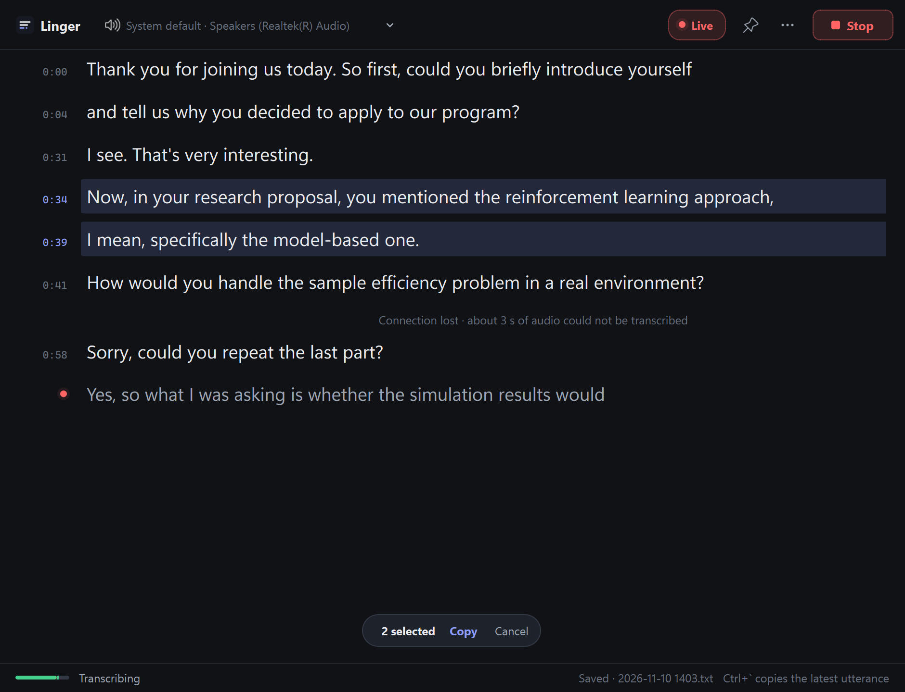

<div align="center">

# Linger

**Real-time captions for any audio playing on your computer — designed to stay still long enough to read, select, and copy.**

[](https://github.com/BocchiJamSuki/linger/actions/workflows/tests.yml)
[](LICENSE)


**English** · [简体中文](README.zh-CN.md)

</div>



## Overview

Linger captures the audio your computer is playing — from a video call, an online lecture, a webinar, or a recorded video — and transcribes it in real time using the [ElevenLabs Scribe](https://elevenlabs.io/speech-to-text) realtime speech-to-text model.

Most live-caption tools are designed to be glanced at: text scrolls past and disappears. Linger is designed to be **worked with**. Finalized text is never rewritten, the view never moves while you are reading or selecting, and any passage can be copied with a single keystroke from any application — to look up an unfamiliar term, for instance, or to paste a sentence into a translator.

## Features

- **System audio capture** — Records any output device through WASAPI loopback. No virtual audio cable, additional driver, or change to other applications' audio settings is required, and microphone input is never captured.
- **Stable, append-only transcript** — Finalized text is written once and never modified. Only the line currently being recognized updates, and it pauses while it is selected.
- **Segment-level selection** — Click the timestamp gutter to select a whole segment; extend the selection with <kbd>Shift</kbd>, toggle segments with <kbd>Ctrl</kbd>, or drag across several. Free-form text selection across segments is also supported.
- **Global copy hotkey** — Press <kbd>Ctrl</kbd>+<kbd>`</kbd> in any application to copy the most recent utterance. Press again within two seconds to include one more preceding segment.
- **Translator-friendly output** — Multiple segments are joined into a single line, so a sentence interrupted by a pause remains one sentence when pasted.
- **Resilient connection** — Audio keeps being captured while the network is down and is replayed after reconnecting, so a brief interruption normally loses nothing.
- **Follows your audio device** — When the Windows default output changes (for example, when headphones are plugged in), capture moves with it.
- **Automatic saving** — Every segment is appended to a timestamped text file as soon as it is finalized.
- **Multiple languages** — Transcribes English, Chinese, Japanese, Korean, Spanish, French, or German, or detects the language automatically. The interface is available in English and Simplified Chinese.
- **Light and dark themes**, adjustable text size, an always-on-top mode, and a built-in self-test.

## Requirements

- Windows 10 or Windows 11
- An [ElevenLabs](https://elevenlabs.io) API key with access to realtime speech-to-text

## Installation

### Download

Download `Linger-<version>-win64.zip` from the [latest release](https://github.com/BocchiJamSuki/linger/releases/latest), extract it anywhere, and run `Linger.exe`. No installation is required.

The executable is not code-signed, so Windows SmartScreen may show a warning the first time it runs; choose **More info → Run anyway**.

### From source

Requires Python 3.13 or later.

```powershell
git clone https://github.com/BocchiJamSuki/linger.git
cd linger
.\setup.cmd
```

`setup.cmd` creates a virtual environment in `.venv` and installs the dependencies. Launch with **`Start Linger.cmd`** or `.\.venv\Scripts\python.exe main.py`.

## Configuration

Open **⋯ → API key** and paste your ElevenLabs API key. The key starts with `sk_` and is displayed only once, when it is created or rotated; the key's ID, which the ElevenLabs dashboard shows afterwards, is not the key. The key is stored in Windows Credential Manager.

Alternatively, Linger reads the key from the `ELEVENLABS_API_KEY` environment variable, or from a `.env` file next to the program:

```dotenv
ELEVENLABS_API_KEY=sk_your-api-key
```

A key saved in the application takes precedence over the environment variable, which takes precedence over the file.

## Usage

1. Select an audio source in the toolbar. **System default** follows the Windows default output device, including when it changes during a session. If the application you want to transcribe plays through a specific device, select that device instead.
2. Choose the spoken language under **⋯ → Spoken language** (English by default).
3. Click **Start**. A connection to ElevenLabs is opened only at this point; launching the application does not capture audio or incur usage.
4. Click **Stop** to end the session. Words not yet finalized are retained and shown in italics.

Before an important session, choose **⋯ → Run self-test** to confirm that audio is being captured and that the API key is valid. Enabling Windows *Do Not Disturb* prevents notification sounds from being transcribed.

If no sound has been detected since the session started, the status indicator changes to **No sound** and the status bar explains what to check.

### Selecting and copying text

Speech is segmented at natural pauses rather than at sentence boundaries, so a single sentence — or a later correction to it — may span several segments. Linger offers several ways to capture exactly what is needed:

| To copy | Action |
| --- | --- |
| The most recent utterance | Press <kbd>Ctrl</kbd>+<kbd>`</kbd> in any application. Press again to reach one segment further back. |
| One or more whole segments | Click a timestamp. <kbd>Shift</kbd>+click selects a range, <kbd>Ctrl</kbd>+click adds or removes a segment, and dragging along the gutter selects consecutive segments. |
| Any span of words | Drag across the text, including across segments. |
| The entire transcript | **⋯ → Copy all** |

While a selection exists, or after scrolling up, the view stops following new text. A **Jump to latest** button appears for returning to the live position.

### Keyboard shortcuts

| Shortcut | Action |
| --- | --- |
| <kbd>Ctrl</kbd>+<kbd>`</kbd> | Copy the most recent utterance (system-wide) |
| <kbd>Ctrl</kbd>+<kbd>C</kbd> | Copy the current selection |
| <kbd>Esc</kbd> | Clear the selection |
| <kbd>Ctrl</kbd>+<kbd>=</kbd> / <kbd>Ctrl</kbd>+<kbd>-</kbd> | Increase / decrease text size |

The system-wide hotkey can be changed to <kbd>Alt</kbd>+<kbd>`</kbd>, <kbd>F8</kbd>, or <kbd>F9</kbd>, or disabled, under **⋯ → Global copy hotkey**.

## Reliability

- **Audio and network are independent.** Audio is captured continuously for the whole session. While the connection is down it is held in a 20-second buffer; once the connection returns, the buffered audio is sent first, together with any audio whose words had not yet been finalized. A drop in the middle of a sentence is therefore normally invisible in the transcript.
- **Honest about loss.** If an outage outlasts the buffer, the transcript states how many seconds of audio could not be transcribed, and the words that were in progress are kept and marked as unconfirmed.
- **Persistent reconnection.** A dead connection is detected within about five seconds, and Linger keeps retrying for as long as the session runs. A session stops by itself only on errors that retrying cannot resolve, such as an invalid key or an exhausted quota.
- **Self-healing capture.** If the audio device fails or is removed, capture restarts on its own without interrupting the connection.
- **Low bandwidth.** Audio is sent as 16 kHz mono, about 0.35 Mbit/s of upload, leaving headroom for a simultaneous video call.
- **Single instance.** Launching Linger a second time brings the running window to the front instead of starting a second, separately billed session.

## Data and privacy

- Audio is sent to ElevenLabs only while a session is running. Launching the application, selecting a device, and the audio portion of the self-test are entirely local.
- The API key is stored in Windows Credential Manager (or read from the environment), held in memory, and used only in the connection request header. It is never written to logs, transcripts, or URLs.
- Transcripts are saved locally to `Documents\Linger\` as timestamped UTF-8 text files. No other data is stored or transmitted.
- Preferences (audio source, languages, theme, text size, hotkey, and window position) are stored in the Windows registry under `HKEY_CURRENT_USER\Software\Linger`.

## Limitations

- Windows only; audio capture relies on WASAPI loopback.
- Recognition accuracy, latency, language coverage, and pricing are determined by the ElevenLabs service.
- Capture level follows the system volume. Linger compensates for a low volume setting, but the output device must not be muted.

## Development

```text
linger/
├── audio.py        WASAPI loopback capture, levelling, device following, self-healing feed
├── scribe.py       Credentials lookup, connection parameters, event decoding, error classification
├── engine.py       Worker thread: audio pump, streaming, replay after reconnection, self-test
├── transcript.py   Segment model, utterance grouping, autosave
├── view.py         Transcript view: append-only stream, gutter selection, follow behaviour
├── window.py       Main window
├── keydialog.py    API key dialog
├── credentials.py  Windows Credential Manager access
├── hotkey.py       System-wide hotkey (Win32 RegisterHotKey)
├── i18n.py         Interface strings (English, Simplified Chinese)
└── theme.py        Palettes, stylesheet, icons, title bar tinting
```

Run the test suite (network access is restricted to localhost):

```powershell
.\.venv\Scripts\python.exe -m pytest -q
```

Build the executable into `dist\Linger\`:

```powershell
.\.venv\Scripts\python.exe -m pip install -r requirements-build.txt
.\.venv\Scripts\python.exe -m PyInstaller --noconfirm linger.spec
```

Regenerate the screenshots in `docs/` with `tools\preview.py`. Releases are built by GitHub Actions when a version tag is pushed.

Transcription uses the `scribe_v2_realtime` model with voice-activity-based commits (0.7 s silence threshold). Audio is transmitted as 16 kHz mono 16-bit PCM in 100 ms chunks.

## License

Released under the [MIT License](LICENSE).
