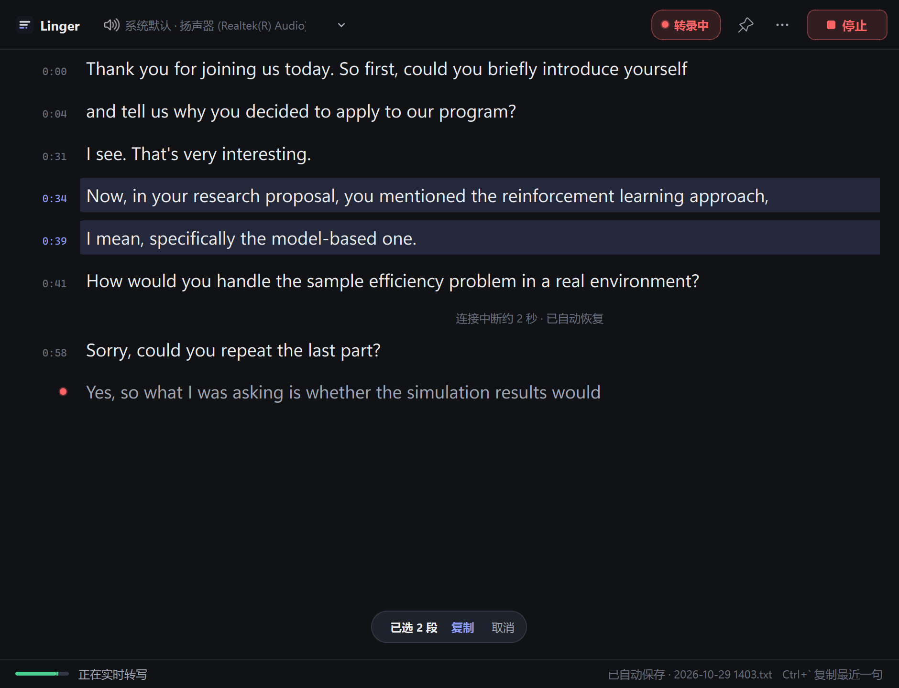

# Linger

**说过的话，会停留到你看懂为止。**

面试用的英语实时字幕。录下电脑正在播放的声音（例如 Zoom 里教授的声音），用 ElevenLabs Scribe 实时转写成文字。哪句没听懂，可以马上选中复制，拿去翻译。



## 使用

1. 双击 **Start Linger.cmd**（首次使用先运行 `setup.cmd`）。
2. 左上角选择音频来源，一般保持「系统默认」即可。
3. 点 **开始**。到这一步才会连接 ElevenLabs 并开始计费。

不需要 VB-CABLE，也不需要改 Zoom 的任何设置。程序录的是系统送往扬声器的数字信号，用笔记本扬声器或耳机都一样，也录不到你自己的麦克风。

**面试前**：在「⋯ → 面试前自检」里检查一遍。它会先监听扬声器 3 秒，再连一次 API，确认密钥有效。另外请打开 Windows 的「勿扰」，免得通知音被录进去。

> 「系统默认」会跟随 Windows 当前的输出设备。如果 Zoom 的扬声器设置成了某个特定设备（而不是「与系统相同」），这里也选同一个。

### 密钥

按顺序读取 `ELEVENLABS_API_KEY`：进程环境变量 → Windows 用户 / 系统环境变量 → 程序目录下的 `.env` 或 `.env.txt`：

```
ELEVENLABS_API_KEY=你的密钥
```

密钥只在内存中用于握手请求头，不会进入日志或文件。

## 复制一句话

教授的话是按**停顿**切成段的，不是按句子切的。所以一句话可能被切成几段，事后的补充或纠正也是单独的一段。下面几种方式都可以把需要的部分完整拿到：

| 想要 | 怎么做 |
|---|---|
| 刚刚说的那句 | 在**任何窗口**（包括 Zoom 里）按 `` Ctrl+` ``。2 秒内再按一次，就往前多带一段 |
| 某几段 | 点左侧的时间选中一段；按住 Shift 点另一段，选中中间所有段；按住 Ctrl 点，挑选不连续的几段；也可以按住拖动 |
| 任意几个词 | 直接在文字上拖选，可以跨段 |

多段合并时用空格连接，粘贴到翻译软件里就是一句完整的话。

**内容不会乱跑**：已经确定的文字只会在下方追加，从不改动。你在选择时屏幕不会滚动，往上翻看时也会自动停止跟随，底部出现「回到最新」按钮。唯一会变化的是最后一行灰色的「正在识别」文字，你选中它时它也会暂停更新。

快捷键可以在「⋯ → 全局复制快捷键」里换成 `` Alt+` ``、F8、F9 或关闭。

## 可靠性

- **断线自动重连**：网络抖动或服务端超时后会立刻重连（0.3 秒起，逐步退避），不需要任何操作。文字里会标出「连接中断约 N 秒」，断线时没说完的那半句以灰色斜体保留。只有密钥无效、额度用完这类重连也解决不了的错误才会停止。
- **自动保存**：每一段都会实时写入 `文档\Linger\日期 时间.txt`，带时间戳。关窗口、程序崩溃都不会丢。
- **不做静音自动暂停**：你回答问题时教授是安静的，如果因此暂停，下一个问题开头那一两秒就会漏掉。

## 其他

- 右上角图钉：窗口置顶，可以盖在 Zoom 上方。
- `Ctrl =` / `Ctrl -` 调整字号。外观可以选浅色、深色或跟随系统。
- 设置（音频来源、字号、主题、快捷键、窗口位置）都会被记住。

## 开发

```
linger/
  audio.py       WASAPI 扬声器回环采集、降混为单声道 PCM16、100 ms 分包
  scribe.py      密钥读取、连接参数、事件解码与错误分级（致命 / 可重试）
  engine.py      工作线程：asyncio 收发、自动重连、自检；通过 Mailbox 交给界面
  transcript.py  段落模型、「最近一句」分组、自动保存
  view.py        转录视图：追加式文字流、时间栏多选、跟随与冻结逻辑
  hotkey.py      Win32 全局快捷键
  window.py      主窗口
  theme.py       配色、样式表、图标、Windows 标题栏着色
```

```powershell
.\.venv\Scripts\python.exe -m pytest -q          # 只连本机，禁止外部 DNS 和网络
.\.venv\Scripts\python.exe tools\preview.py      # 用示例文字渲染界面截图到 docs/
```

参数：`scribe_v2_realtime`，`language_code=en`，VAD 提交（静音 0.7 s）。音频以设备原生的 48 kHz 单声道 PCM16 发送，每块 100 ms。音频积压超过 500 ms 或单次发送超过 1 s 时，会丢弃旧音频并重新同步，避免越听越落后。
