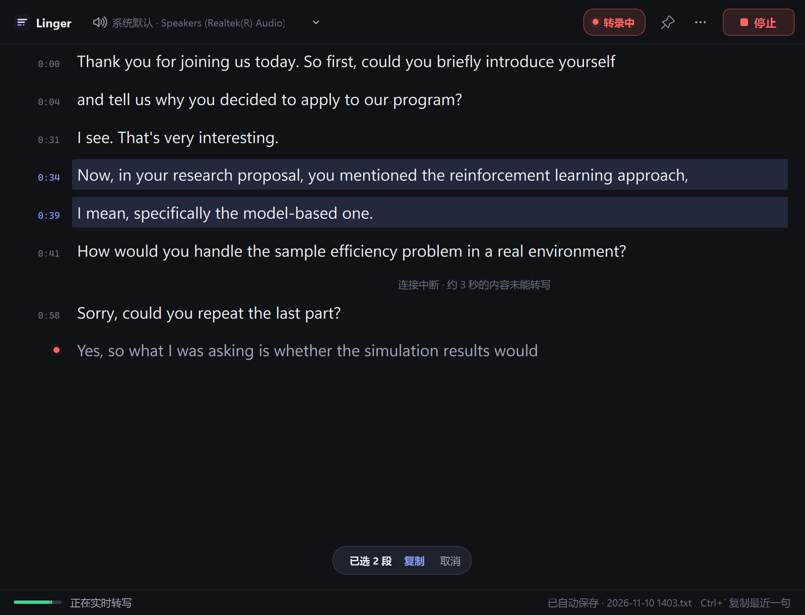

<div align="center">

# Linger

**为电脑中播放的任何音频生成实时字幕——文字保持稳定，便于阅读、选取与复制。**

[](https://github.com/BocchiJamSuki/linger/actions/workflows/tests.yml)
[](LICENSE)


[English](README.md) · **简体中文**

</div>



## 简介

Linger 采集电脑正在播放的音频（视频通话、在线课程、网络研讨会、录播视频等），并借助 [ElevenLabs Scribe](https://elevenlabs.io/speech-to-text) 实时语音识别模型，将其实时转写为文本。

大多数实时字幕工具只供浏览：文字滚动而过，随即消失。Linger 则面向**实际使用**而设计：已确定的文字不再改写；阅读或选取时，视图保持静止；在任意应用程序中按一次快捷键，即可复制任意内容，例如查询生词，或将句子粘贴到翻译工具中。

## 功能特性

- **系统音频采集**：通过 WASAPI 回环录制任意输出设备。无需虚拟声卡或额外驱动，无需修改其他应用程序的音频设置，也不会采集麦克风输入。
- **稳定的追加式文本**：已确定的文字只写入一次，此后不再修改。唯一会更新的是正在识别的最后一行；该行被选中时也会暂停更新。
- **按段落选取**：单击左侧时间栏可选中整段；按住 <kbd>Shift</kbd> 扩展选区，按住 <kbd>Ctrl</kbd> 添加或移除段落，也可拖动选取多段。同时支持跨段落的自由文本选取。
- **全局复制快捷键**：在任意应用程序中按 <kbd>Ctrl</kbd>+<kbd>`</kbd> 即可复制最近一句话；两秒内再次按下，可向前多包含一段。
- **便于翻译的输出**：多段内容合并为一行文本，因停顿而被切开的句子粘贴后仍是一个完整的句子。
- **稳健的连接**：网络中断期间音频照常采集，重连后自动补发，短暂的中断通常不会丢失任何内容。
- **跟随音频设备**：Windows 默认输出设备发生变化时（例如插入耳机），采集会自动切换到新设备。
- **自动保存**：每一段文字确定后，即刻写入带时间戳的文本文件。
- **多语言**：可转写英语、中文、日语、韩语、西班牙语、法语、德语，或自动检测语言。界面提供简体中文与英文。
- 支持**浅色与深色主题**、字号调节、窗口置顶及内置自检。

## 系统要求

- Windows 10 或 Windows 11
- 已开通实时语音识别权限的 [ElevenLabs](https://elevenlabs.io) API 密钥

## 安装

### 下载

从[最新发布页](https://github.com/BocchiJamSuki/linger/releases/latest)下载 `Linger-<版本号>-win64.zip`，解压到任意位置，运行 `Linger.exe` 即可，无需安装。

可执行文件未经代码签名，首次运行时 Windows SmartScreen 可能给出警告，请选择**更多信息 → 仍要运行**。

### 从源码运行

需要 Python 3.13 或更高版本。

```powershell
git clone https://github.com/BocchiJamSuki/linger.git
cd linger
.\setup.cmd
```

`setup.cmd` 会在 `.venv` 中创建虚拟环境并安装依赖。之后运行 **`Start Linger.cmd`**，或执行 `.\.venv\Scripts\python.exe main.py`。

## 配置

打开 **⋯ → API 密钥**，粘贴您的 ElevenLabs API 密钥。密钥以 `sk_` 开头，仅在创建或轮换时显示一次；此后 ElevenLabs 控制台中显示的是密钥的 ID，并非密钥本身。密钥保存在 Windows 凭据管理器中。

此外，Linger 也会从环境变量 `ELEVENLABS_API_KEY`，或程序所在目录的 `.env` 文件中读取密钥：

```dotenv
ELEVENLABS_API_KEY=sk_your-api-key
```

优先级依次为：在程序中保存的密钥、环境变量、`.env` 文件。

## 使用方法

1. 在工具栏中选择音频来源。**系统默认**会跟随 Windows 的默认输出设备，会话过程中设备发生变化时也会随之切换；如果待转写的应用程序使用特定设备播放声音，请选择该设备。
2. 在 **⋯ → 转写语言** 中选择说话的语言（默认为英语）。
3. 单击**开始**。此时才会连接 ElevenLabs；仅启动程序不会采集音频，也不会产生用量。
4. 单击**停止**结束会话。尚未确定的文字会被保留，并以斜体显示。

在重要场合使用前，建议通过 **⋯ → 运行自检** 确认音频采集正常、API 密钥有效。开启 Windows 的「勿扰」模式，可避免通知音被转写。

如果会话开始后始终没有检测到声音，状态指示会变为**无声音**，状态栏会说明需要检查的事项。

### 选取与复制文字

语音按自然停顿切分为段落，而非按句子切分。因此，一个句子（或之后对它的补充、更正）可能分布在多个段落中。Linger 提供以下几种方式，帮助您准确获取所需内容：

| 复制内容 | 操作方法 |
| --- | --- |
| 最近一句话 | 在任意应用程序中按 <kbd>Ctrl</kbd>+<kbd>`</kbd>；再次按下可向前多包含一段。 |
| 一个或多个完整段落 | 单击时间戳。<kbd>Shift</kbd>+单击选取连续范围，<kbd>Ctrl</kbd>+单击添加或移除段落，沿时间栏拖动可选取连续多段。 |
| 任意文字片段 | 在文字上拖动选取，可跨越段落。 |
| 全部文本 | **⋯ → 复制全部内容** |

存在选区或向上滚动后，视图将停止跟随新内容，并出现**回到最新**按钮，可随时返回实时位置。

### 键盘快捷键

| 快捷键 | 功能 |
| --- | --- |
| <kbd>Ctrl</kbd>+<kbd>`</kbd> | 复制最近一句话（全局有效） |
| <kbd>Ctrl</kbd>+<kbd>C</kbd> | 复制当前选区 |
| <kbd>Esc</kbd> | 取消选区 |
| <kbd>Ctrl</kbd>+<kbd>=</kbd> / <kbd>Ctrl</kbd>+<kbd>-</kbd> | 放大 / 缩小字号 |

全局快捷键可在 **⋯ → 全局复制快捷键** 中更改为 <kbd>Alt</kbd>+<kbd>`</kbd>、<kbd>F8</kbd> 或 <kbd>F9</kbd>，也可以关闭。

## 可靠性

- **音频与网络相互独立**：整个会话期间音频持续采集。连接中断时，音频保存在 20 秒的缓冲区中；连接恢复后，先补发缓冲的音频，以及此前已发送但文字尚未确定的部分。因此，句子中途发生的短暂中断通常不会在文本中留下痕迹。
- **如实标注丢失**：若中断时间超出缓冲容量，文本中会注明有多少秒的音频未能转写，中断时正在识别的文字会被保留并标记为未确认。
- **持续重连**：连接失效可在约 5 秒内被发现；会话运行期间，Linger 会一直重试。仅当遇到重试无法解决的错误（如密钥无效、额度耗尽）时，会话才会自行停止。
- **采集自恢复**：音频设备出错或被移除时，采集会自动重启，且不影响网络连接。
- **低带宽占用**：音频以 16 kHz 单声道发送，上行约 0.35 Mbit/s，可与视频通话同时使用。
- **单实例运行**：再次启动 Linger 时，会将已运行的窗口切换到前台，而不会开启第二个单独计费的会话。

## 数据与隐私

- 仅在会话进行期间向 ElevenLabs 发送音频。启动程序、选择设备以及自检中的音频检测环节均在本地完成。
- API 密钥保存在 Windows 凭据管理器中（或读取自环境变量），运行时仅存在于内存，且只用于连接请求头，不会写入日志、转写文本或 URL。
- 转写文本以带时间戳的 UTF-8 文本文件形式保存在本地 `文档\Linger\` 目录中。除此之外，不存储或传输任何其他数据。
- 偏好设置（音频来源、语言、主题、字号、快捷键及窗口位置）保存在 Windows 注册表 `HKEY_CURRENT_USER\Software\Linger` 下。

## 已知限制

- 仅支持 Windows，音频采集依赖 WASAPI 回环。
- 识别准确率、延迟、语言覆盖范围与费用由 ElevenLabs 服务决定。
- 采集音量随系统音量变化。Linger 会对较低的音量进行补偿，但输出设备不能处于静音状态。

## 开发

```text
linger/
├── audio.py        WASAPI 回环采集、音量补偿、设备跟随、自恢复音频源
├── scribe.py       凭据查找、连接参数、事件解析、错误分级
├── engine.py       工作线程：音频泵、流式传输、重连后补发、自检
├── transcript.py   段落模型、语句分组、自动保存
├── view.py         转写视图：追加式文本流、时间栏选取、跟随逻辑
├── window.py       主窗口
├── keydialog.py    API 密钥对话框
├── credentials.py  Windows 凭据管理器访问
├── hotkey.py       全局快捷键（Win32 RegisterHotKey）
├── i18n.py         界面文本（简体中文、英文）
└── theme.py        配色、样式表、图标、标题栏着色
```

运行测试（网络访问仅限本机）：

```powershell
.\.venv\Scripts\python.exe -m pytest -q
```

构建可执行文件到 `dist\Linger\`：

```powershell
.\.venv\Scripts\python.exe -m pip install -r requirements-build.txt
.\.venv\Scripts\python.exe -m PyInstaller --noconfirm linger.spec
```

使用 `tools\preview.py` 可重新生成 `docs/` 中的截图。推送版本标签后，发布包由 GitHub Actions 自动构建。

转写使用 `scribe_v2_realtime` 模型，基于语音活动检测提交段落（静音阈值 0.7 秒）。音频以 16 kHz 单声道 16 位 PCM 格式、每块 100 毫秒发送。

## 许可证

本项目基于 [MIT 许可证](LICENSE) 发布。
